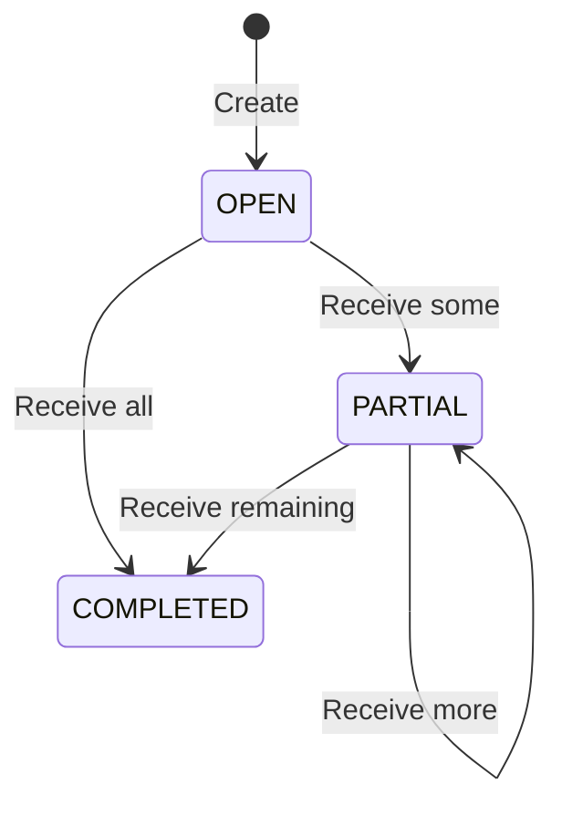

# Technical Specification

> Sumber: [PROJECT_SPEC.md](source/PROJECT_SPEC.md). Fondasi Task 2, autentikasi/security Task 3 dan core receiving Task 4 telah diimplementasikan; user management belum tersedia. Lihat [testing.md](testing.md) untuk status dan konteks asal bukti.

## Baseline teknologi

| Bagian | Pilihan |
| --- | --- |
| Runtime backend | Node.js 24 |
| Backend | Express 5 + TypeScript strict |
| ORM | Prisma ORM 7 |
| Database | PostgreSQL 17 |
| Session dan limiter store | Redis |
| Validation | Zod |
| Session | express-session + connect-redis |
| CSRF | Synchronizer token melalui csrf-sync |
| Password | Argon2id |
| Rate limiting | express-rate-limit + rate-limit-redis |
| Backend testing | Vitest + Supertest |
| Deployment | Docker Compose dan nginx |

Versi patch harus dipilih saat scaffolding, diperiksa kompatibilitasnya, lalu dikunci dalam lockfile. Prisma CLI, Client, dan adapter harus menggunakan versi yang kompatibel.

## Arsitektur dan dependency direction

Alur request:
Route → Middleware → Controller → Service → Repository → Prisma/PostgreSQL

Ketentuannya:

- Controller tidak mengakses Prisma secara langsung.
- Repository tidak menerima Request atau Response Express.
- Service menentukan aturan bisnis dan transaction boundary.
- Mapper mengubah database model menjadi DTO.
- Mapper tidak menjalankan query atau mengubah database.
- Service boleh mengoordinasikan beberapa repository dalam satu transaksi.
- Repository yang berjalan dalam transaksi harus menerima Prisma.TransactionClient.
- Operasi dalam transaksi tidak boleh menggunakan Prisma Client global sebagai jalan pintas.
- Tidak membuat generic base repository jika belum diperlukan.
app.ts membentuk aplikasi dan menerima dependency yang dibutuhkan untuk pengujian.

server.ts memuat konfigurasi, menghubungkan dependency, menjalankan listener, dan menangani shutdown.

## Konfigurasi Prisma multi-file

Untuk Prisma multi-file, arahkan CLI ke folder schema agar model di subfolder ikut terbaca. Prisma Client dihasilkan ke lokasi yang kamu minta. Pola folder dan custom output ini didukung dokumentasi Prisma. Prisma Documentation

Isi konfigurasi yang harus diwujudkan:

```text
schema directory: prisma/
main schema: prisma/schema.prisma
model files: prisma/models/*.prisma
migrations: prisma/migrations/
seed entry: prisma/seeds/index.ts
generated client: src/generated/prisma/
```

Aturan:

- Generator menggunakan prisma-client.
- Output relatif dari schema.prisma adalah ../src/generated/prisma.
- Prisma Client hasil generate tidak diedit manual.
- Environment lokal dimuat dari env/.env.
- Runtime Prisma menggunakan adapter PostgreSQL yang sesuai dengan Prisma 7.
- Build dan Docker build menjalankan Prisma generate.
- Generated client tidak diimpor oleh frontend.
- Gunakan ESM dengan konfigurasi TypeScript dan import yang konsisten.
Desain database

Semua identifier entitas menggunakan UUID. Timestamp menggunakan PostgreSQL timestamptz.

Nama model Prisma menggunakan PascalCase. Nama tabel dan kolom PostgreSQL menggunakan snake_case melalui mapping Prisma.

| Tabel | Kolom |
| --- | --- |
| users | id uuid PK, email varchar(254) UNIQUE, name varchar(120), password_hash text, role enum, is_active boolean, auth_version integer, deleted_at timestamptz NULL, created_at timestamptz, updated_at timestamptz |
| products | id uuid PK, sku varchar(40) UNIQUE, name varchar(120), unit varchar(8), created_at timestamptz |
| receivings | id uuid PK, number varchar(40) UNIQUE, reference varchar(160), status enum, created_by uuid FK users, created_at timestamptz, updated_at timestamptz |
| receiving_items | id uuid PK, receiving_id uuid FK, product_id uuid FK, expected_quantity integer, received_quantity integer |
| receipts | id uuid PK, receiving_id uuid FK, actor_id uuid FK users, idempotency_key uuid, payload_hash char(64), received_at timestamptz |
| inventory_transactions | id uuid PK, receipt_id uuid, receiving_id uuid, receiving_item_id uuid, product_id uuid, quantity integer, created_at timestamptz |
| inventory_balances | product_id uuid PK/FK, available_quantity bigint, updated_at timestamptz |

Default:

- ID dibuat oleh server/database.
- users.is_active = true.
- users.auth_version = 1.
- users.deleted_at = null.
- products.unit = pcs.
- receivings.status = OPEN.
- receivings.reference = "".
- receiving_items.received_quantity = 0.
- inventory_balances.available_quantity = 0.
Nomor dokumen:
RCV-<UUID uppercase lengkap>

Panjangnya 40 karakter dan dibuat server.

## Constraint database

Wajib diwujudkan melalui Prisma dan SQL migration:

```text
UNIQUE users(email)
CHECK users(email = lower(email))
CHECK users(auth_version >= 1)
```

```text
UNIQUE products(sku)
CHECK products(sku matches ^[A-Z0-9_-]+$)
CHECK products(unit = 'pcs')
```

```text
UNIQUE receiving_items(receiving_id, product_id)
UNIQUE receiving_items(id, receiving_id, product_id)
CHECK receiving_items(expected_quantity BETWEEN 1 AND 1000000)
CHECK receiving_items(received_quantity >= 0)
CHECK receiving_items(received_quantity <= expected_quantity)
```

```text
UNIQUE receipts(receiving_id, idempotency_key)
UNIQUE receipts(id, receiving_id)
```

```text
UNIQUE inventory_transactions(receipt_id, receiving_item_id)
CHECK inventory_transactions(quantity BETWEEN 1 AND 1000000)
```

```text
CHECK inventory_balances(available_quantity >= 0)
```

Composite foreign key:

- (receipt_id, receiving_id) pada inventory transaction merujuk (id, receiving_id) pada receipt.
- (receiving_item_id, receiving_id, product_id) merujuk kombinasi yang sama pada receiving item.
Tujuannya memastikan receipt, receiving item, dokumen, dan produk dalam satu transaksi benar-benar konsisten.

Semua referensi historis menggunakan delete restriction. User hanya dihapus secara soft delete.

Index tambahan:
users(role, is_active)
users(created_at, id)

receivings(status, created_at, id)
receivings(created_at, id)

receiving_items(product_id)

receipts(actor_id)

inventory_transactions(product_id, created_at, id)
inventory_transactions(receiving_id, created_at, id)
inventory_transactions(receiving_item_id)
inventory_transactions(created_at, id)

## Inventory strategy

Gunakan dua representasi:

- inventory_transactions: ledger penerimaan.
- inventory_balances: saldo untuk pembacaan stok.
Keduanya diperbarui dalam transaksi PostgreSQL yang sama.

Invariant:
inventory_balances.available_quantity
=
SUM(inventory_transactions.quantity) untuk produk tersebut

Invariant tambahan:
receiving_items.received_quantity
=
SUM(inventory_transactions.quantity) untuk receiving item tersebut

availableQuantity dikirim sebagai decimal string, karena kolom database menggunakan bigint.

Contoh:

```json
{
  "availableQuantity": "100"
}
```

Saldo stok tidak di-cache di Redis pada versi ini.

## Session authentication

Session hanya menyimpan identitas minimum:

```typescript
interface SessionData {
  userId?: string;
  authVersion?: number;
  authenticatedAt?: number;
  lastActivityAt?: number;
  anonymousCreatedAt?: number;
  csrfToken?: string;
}
```

Role otoritatif dibaca dari database pada setiap request terautentikasi.

Gunakan:

- Redis session store.
- resave: false.
- saveUninitialized: false.
- Rolling cookie untuk idle session.
- Cookie HttpOnly.
- Cookie host-only, tanpa atribut Domain.
- SameSite=Lax.
- Secure cookie untuk deployment HTTPS.
- Nama cookie lokal wrs.sid.
- Nama cookie HTTPS production __Host-wrs.sid, dengan Path /.
Cookie browser membawa session identifier; isi session disimpan di server. Konfigurasi secure cookie dan trusted proxy harus sesuai deployment. Express.js

Kebijakan waktu yang dipilih:

| Session | Batas |
| --- | --- |
| Anonymous/pre-login | Maksimal 15 menit |
| Authenticated idle timeout | 30 menit |
| Authenticated absolute lifetime | 8 jam sejak login |

TTL Redis dan cookie expiration harus konsisten. TTL session terautentikasi tidak boleh melampaui sisa absolute lifetime. connect-redis mendukung TTL dan mekanisme touch; pengaturannya harus disesuaikan dengan kebijakan ini. GitHub

Pada setiap protected request:

1. Pastikan session memiliki userId.
2. Periksa absolute lifetime.
3. Ambil user dari PostgreSQL.
4. Pastikan aktif dan belum terhapus.
5. Bandingkan session.authVersion dengan user.authVersion.

6. Isi req.user dari data database.
7. Jalankan authorization.
Session tidak valid menghasilkan 401. Kegagalan akses Redis/PostgreSQL menghasilkan 503, bukan dianggap kredensial salah.

## Login dan CSRF flow

Gunakan synchronizer token yang terikat session. Token dikirim melalui JSON response dan dikembalikan frontend melalui X-CSRF-Token. Login juga dilindungi menggunakan pre-login session. Setelah login berhasil, buat session baru untuk mencegah session fixation. Pola ini mengikuti panduan OWASP dan tersedia melalui csrf-sync. OWASP Cheat Sheet Series

Alur yang ditetapkan:
1. Frontend meminta GET /api/v1/auth/csrf-token.
2. Backend membuat anonymous session bila diperlukan.
3. Backend membuat token acak minimal 32 byte dan menyimpannya dalam session.
4. Backend menyimpan session sebelum mengirim token.
5. Frontend menyimpan token dalam memory.
6. Frontend mengirim login dengan cookie dan header CSRF.
7. Backend memvalidasi CSRF, input, rate limit, dan password.
8. Setelah kredensial valid, backend menjalankan session regeneration.
9. Session baru diisi userId, authVersion, dan authenticatedAt.
10. Buat CSRF token baru untuk session baru.
11. Simpan session baru sebelum mengirim response login.
12. Response berisi user dan CSRF token baru.
Ketentuan tambahan:
- Token stabil selama session tersebut berlaku.
- GET /csrf-token mengembalikan token yang masih berlaku, bukan selalu merotasinya.
- POST, PATCH, PUT, dan DELETE wajib menjalani pemeriksaan CSRF.
- Token tidak dikirim melalui URL atau ditulis ke log.
- Mutating request wajib memakai JSON.
- Periksa Origin terhadap APP_ORIGIN; bila tidak ada, gunakan origin dari Referer.
- Request perubahan data tanpa Origin/Referer yang dipercaya ditolak dalam aplikasi ini.
- GET bisnis tidak mengubah state bisnis.
- Endpoint CSRF bootstrap hanya menginisialisasi state keamanan session.
Logout menghancurkan session Redis, menunggu hasilnya, lalu menghapus cookie dengan atribut yang sesuai.

## Password security

Password menggunakan Argon2id dengan salt otomatis. Baseline minimal:

```text
memoryCost: 19456 KiB
timeCost: 2
parallelism: 1
```


Parameter tersebut mengikuti rekomendasi minimum OWASP; waktu hashing perlu diperiksa di lingkungan implementasi. OWASP Cheat Sheet Series

Tidak menyimpan plaintext password, tidak mengembalikan hash, dan menggunakan pesan login umum untuk kredensial salah maupun akun yang tidak dapat digunakan.

## User management dan session revocation
- Create user mewajibkan role eksplisit.
- Update hanya menerima name, role, isActive.
- Perubahan role/status yang benar-benar terjadi menaikkan authVersion.
- Soft delete mengisi deletedAt, mengubah isActive=false, dan menaikkan authVersion.
- Perubahan nama saja tidak membatalkan session.
- Semua user-management mutation mengambil satu PostgreSQL transaction advisory lock yang sama.
- Setelah lock diperoleh, periksa kembali actor masih supervisor aktif.
- Evaluasi invariant minimal satu supervisor aktif di dalam transaksi tersebut.
- Penghapusan ulang user yang sudah terhapus menghasilkan 204 tanpa perubahan tambahan.
Penggunaan lock di sini mencegah dua supervisor melakukan perubahan bersamaan yang melanggar invariant akun.

## Redis dan rate limiting

Redis digunakan untuk:

```text
wrs:sess:*            session
wrs:rl:global:*       global IP limiter
wrs:rl:login-ip:*     login IP limiter
wrs:rl:login-pair:*   login IP + normalized-email limiter
wrs:rl:user:*         authenticated-user limiter
```


Setiap limiter memiliki store/prefix terpisah. rate-limit-redis menyediakan shared store bagi express-rate-limit. GitHub

Batas awal yang dipilih:

| Limiter | Batas |
| --- | --- |
| Seluruh /api/v1 per IP | 300 request/menit |
| Login per IP | 10 request/15 menit |
| Login per IP + email | 5 request/15 menit |
| Protected API per user | 120 request/menit |


Ketentuan:
- Login limiter menghitung percobaan tanpa membocorkan keberadaan email.
- Key email menggunakan hash dari email yang dinormalisasi.
- Penanganan IP menggunakan dukungan IPv4/IPv6 dari library.
- Response limit adalah 429 dengan Retry-After.
- Gangguan store menghasilkan 503; limit tidak dilewati.
- Atur passOnStoreError agar request ditolak saat store gagal.
- trust proxy harus sesuai topologi proxy, bukan menerima seluruh forwarded header tanpa batas.
- Health endpoints tidak melewati session dan limiter bisnis.
Konfigurasi perilaku store error dan respons limiter tersedia pada dokumentasi library. express-rate-limit

## Receiving transaction

Gunakan Prisma interactive transaction. Locking yang membutuhkan SQL dijalankan melalui parameterized raw query pada transaction client yang sama. Prisma mendukung kedua mekanisme tersebut. prisma.io

Urutannya wajib:
1. Authentication, authorization, CSRF, dan validasi input selesai.
2. Normalisasi UUID menjadi lowercase.
3. Urutkan payload item berdasarkan receivingItemId.
4. Hitung SHA-256 dari:
   - Receiving ID.
   - Actor ID.
   - Array item yang telah dinormalisasi.
5. Mulai transaksi PostgreSQL READ COMMITTED.
6. Lock row receiving menggunakan SELECT ... FOR UPDATE.
7. Cari receipt berdasarkan (receivingId, idempotencyKey).
8. Jika ditemukan:
   - Hash sama: kembalikan receipt lama tanpa write.
   - Hash berbeda: 409 IDEMPOTENCY_CONFLICT.
9. Jika belum ditemukan, tolak dokumen completed.
10. Baca dan lock item dokumen.
11. Validasi seluruh item dan remaining quantity sebelum melakukan write.
12. Buat receipt.
13. Increment received quantity setiap item.
14. Buat inventory transaction setiap item.
15. Increment inventory balance menggunakan operasi database atomik.
16. Update balance dalam urutan productId yang konsisten untuk mengurangi deadlock antar dokumen.
17. Hitung status dokumen dari seluruh item.
18. Update dokumen.
19. Commit.
20. Kirim response receipt.
Larangan:
- Membaca remaining quantity sebelum lock lalu memakainya untuk mengambil keputusan.
- Menyimpan idempotency hanya di Redis.
- Melakukan network call atau hashing password di dalam receiving transaction.
- Menulis sebagian perubahan di luar transaction client.
- Mengembalikan sukses sebelum commit.
Replayed receipt diperiksa sebelum penolakan status completed.

Response replay berisi receipt historis yang immutable, bukan snapshot dokumen yang sudah berubah akibat receipt lain.

## State transitions



Tidak ada endpoint manual complete, reopen, cancel, edit expected quantity, atau delete receipt.


## Struktur dan command repository backend mandiri

Seluruh path di dokumen ini relatif root repository backend. package.json/package-lock.json, tsconfig.json, ESLint, .npmrc dan .nvmrc lokal bersifat mandiri. Bukan aplikasi yang memerlukan manifest induk. Node 24.12.0/npm 11.6.2, strict, exactOptionalPropertyTypes true dan skipLibCheck false dipertahankan.

| Path | Peran |
| --- | --- |
| app.ts / server.ts | DI/HTTP app dan startup/listener/shutdown |
| paths.ts | Menemukan package root backend, termasuk ketika dijalankan dari dist |
| src/config / src/lib | Validasi env dan Prisma/Redis clients |
| src/modules/health | Live dan readiness saat ini |
| src/modules / src/common | Lokasi auth/user/produk/receiving/inventory dan middleware saat task tersebut diizinkan |
| prisma / prisma/models | Multi-file database schema |
| prisma/migrations | Seluruh forward SQL migrations dan migration_lock.toml |
| prisma/seeds | Bootstrap akun dari env tanpa mengubah akun lama |
| prisma.generate.config.ts | Offline codegen/schema validate tanpa datasource URL |
| prisma.config.ts | Migration/seed dengan DATABASE_URL eksplisit |
| env/.env.example | Template tanpa secret; env/.env lokal diabaikan |
| tests/unit / tests/integration | Tes fondasi dan fitur mendatang |
| compose.yaml | PostgreSQL/Redis lokal; project default warehouse-receiving-backend |

```powershell
npx --yes --offline=false --package=npm@11.6.2 npm ci --offline=false
npm run lint
npm run prisma:validate
npm run typecheck
npm run build
```

typecheck/build otomatis generate client. Tidak memerlukan env atau layanan database untuk langkah di atas. Tidak ada migration/seed otomatis ketika install/build. Runtime memakai env/.env atau BACKEND_ENV_FILE eksplisit; process variables diutamakan. Runtime/migrate/seed tetap memerlukan credential nyata dan pesan invalid env tidak boleh mencetak value.

```powershell
docker compose --env-file env/.env up -d --wait postgres redis
npm run env:check
npm run db:migrate:deploy
npm run db:seed
npm run dev
```

Command runtime adalah petunjuk untuk env yang diisi pemilik proyek, bukan tindakan yang dijalankan pada pekerjaan dokumentasi. Seed memakai account-management lock 735910001 (src/common/security/account-lock.ts), tidak menimpa field/hash akun existing. Validasi nama seed mengikuti kapasitas varchar(120); unit panjang API R-11 kini Unicode code point, lihat keputusan persiapan Task 4.

Readiness menguji akses tabel/kolom identitas tujuh model dan Redis PING sebelum listener berjalan. Saat berjalan, live independen dan ready gagal mengirim 503 aman. Shutdown menunggu HTTP lalu disconnect Prisma/close Redis dengan deadline 10 detik. Lihat [verification.md](verification.md) dan [testing.md](testing.md) untuk batas bukti.

## Boundary dengan frontend

Frontend adalah aplikasi terpisah melalui HTTP; tidak mengimpor Prisma Client dan tidak menjadi dependency build backend. API pada [api-contract.md](api-contract.md) adalah sumber utama; [api-sync.md](api-sync.md) mengatur replika frontend. Replay tetap memerlukan autentikasi/CSRF yang berlaku; frontend tidak dapat menentukan stock/received total. Tidak ada kewajiban mengedit source frontend dari repository ini.

## Migrasi, scope dan keputusan terbuka

- Deployment memakai migrate deploy, development memakai migrate dev. Jangan db push sebagai deployment atau mengubah applied migration.
- Seluruh CHECK dan composite FK sudah ada pada initial migration; pertahankan bytes semua migrasi. Cardinality child/balance serta invariant status/ledger ditegakkan service yang direncanakan, bukan mengarang trigger baru.
- Compose lokal hanya postgres/redis; API Dockerfile, migration job deployment dan public deployment belum selesai. Jangan menghapus database atau volume existing untuk membuat tes lulus.
- Health/auth dan products/receivings/inventory tersedia; user management Task 5 belum diimplementasikan.
- Desain R-10/R-11/R-13 diputuskan pada [persiapan Task 4](task4-readiness.md); implementasi dan pengujian bisnis tetap NOT_RUN.
- Semua pekerjaan Git/GitHub hanya manual pengguna; agent tidak menjalankan perintah Git atau tool GitHub.


## Detail implementasi Task 3

- src/routes menyusun Redis readiness gate, global limiter, express-session, pemeriksaan CSRF dan JSON strict 64 KiB, lalu auth router. Health berada di luar pipeline session agar liveness tetap bekerja ketika Redis gagal.
- common/cache menggunakan connect-redis dan rate-limit-redis, namespace env default wrs. Rate limits default global 300/menit/IP, login 10/15 menit/IP dan 5/15 menit/IP+email ternormalisasi, protected user 120/menit. Key email memakai SHA256; IP menggunakan ipKeyGenerator dari versi yang sudah diperbaiki. Store error 503; limit 429 dengan Retry-After.
- Session menyimpan lastActivityAt selain identitas minimum. TTL memakai minimum sisa idle/absolute, anonymous dibatasi waktu pembuatannya; cookie maxAge dibatasi sisa yang sama. TTL Redis menggunakan resolusi detik, deadline aplikasi diperiksa dalam milidetik.
- TRUST_PROXY default false, konfigurasi env berupa daftar IP/CIDR atau loopback, bukan boolean true/hop count. HTTPS menolak request yang tidak teridentifikasi secure oleh proxy terpercaya.
- Semua auth response termasuk error no-store. Error body tidak menyertakan detail dependency, input, hash, SID atau token; requestId dibuat server. Password Argon2id dan dummy verification untuk akun tidak ditemukan.
- Authorization role disediakan sebagai middleware dan diuji melalui route khusus test, tidak menerbitkan endpoint bisnis. Reload role/status/authVersion berlaku pada setiap protected request; perubahan account melalui API tetap scope Task 5.


## Desain persiapan Task 4

R-10 mengikuti tabel api-contract.md. Service create receiving memeriksa semua productId melalui transaction client sebelum insert parent/children. Tidak mengandalkan FK error sebagai validasi normal atau memetakan seluruh Prisma error menjadi 404. Tidak menambah lifecycle Product. User endpoints tetap Task 5.

R-11 memakai iterasi code point, bukan string.length JavaScript, sesudah normalisasi field existing. Angka batas dan schema/migrasi varchar tetap; tidak menambah NFC/NFKC atau grapheme segmentation. Parameter OpenAPI mendeskripsikan nilai ternormalisasi; raw whitespace/case diproses sebelum domain validation.

R-13: service read detail membuka Prisma interactive transaction dengan isolationLevel RepeatableRead. Repository menerima Prisma.TransactionClient; semua query header/item/product projection memakai client itu, bukan global Prisma. Mapper hanya mengubah hasil ke DTO. Transaksi ini hanya SELECT, tanpa FOR UPDATE, write atau network/Redis call. SET TRANSACTION READ ONLY dapat dipasang sebagai statement pertama untuk enforcement. Transaksi dibuat singkat. Pilihan ini tetap benar bila relation reads Prisma menghasilkan beberapa SQL statement; tidak mengasumsikan include selalu satu SELECT. Receipt mutation tetap READ COMMITTED dan urutan locking existing.

Dasar: [PostgreSQL 17 isolation](https://www.postgresql.org/docs/17/transaction-iso.html), [character types](https://www.postgresql.org/docs/17/datatype-character.html), [OpenAPI 3.0.3](https://spec.openapis.org/oas/v3.0.3). Tipe Prisma 7.10.1 lokal memuat opsi isolationLevel pada $transaction dan enum RepeatableRead. Dokumentasi Prisma live mengarah ke ORM 8; API ORM 8 tidak dijadikan acuan ORM 7 dan dependency tidak di-upgrade. Ini verifikasi desain/tanda tangan tipe, bukan bukti runtime Task 4.


## Implementasi Task 4

Modul products/receivings/inventory mempunyai schema, repository, mapper, service, controller dan route. Common validation menyimpan UUID lowercase, code-point text refinement, strict query dan pagination. Service menentukan transaksi; semua akses database fitur berada di repository melalui client yang diberikan. Controller hanya adaptasi HTTP dan input; mapper whitelist DTO tanpa hash/session internals.

List data/count memakai snapshot REPEATABLE READ agar pagination total konsisten dengan page. Detail receiving memakai SET TRANSACTION READ ONLY dalam REPEATABLE READ; header/items/product projection seluruhnya melalui transaction client. Create receiving menguji semua productId sebelum write dan memetakan hasil dengan client yang sama sebelum commit.

Receipt canonical hash memakai JSON object berurutan receivingId, actorId, items (receivingItemId lowercase dan quantity), items diurutkan menurut receivingItemId. Key dinormalisasi lowercase dan scoped per receiving oleh unique SQL existing. Parent lock diperoleh sebelum lookup receipt, lalu completed check dan item locks. Seluruh quantity dicek sebelum write; balance increments diurutkan productId. ReceiptDto diambil dari immutable receipt+ledger dengan urutan item tetap. Snapshot current receiving tidak dimasukkan ke replay.

DatabaseOperation mempertahankan AppError domain, memetakan Prisma dependency errors ke 503 serta write conflict/deadlock/lock timeout yang telah rollback ke TRANSACTION_RETRY_REQUIRED. Unexpected programming error diteruskan ke safe 500 handler; raw error/SQL/credential tidak masuk respons.

Tidak ada dependency/schema/migrasi tambahan. PostgreSQL adapter Prisma 7.10.1 dengan pg 8.23.1 mengeluarkan warning query-in-flight pada internal runtime; tes aktual lulus, namun upgrade driver ke pg 9 perlu verifikasi ulang. Source aplikasi tidak memakai Promise.all untuk query dalam satu transaction client. Jangan menonaktifkan warning atau mengganti versi tanpa bukti.
